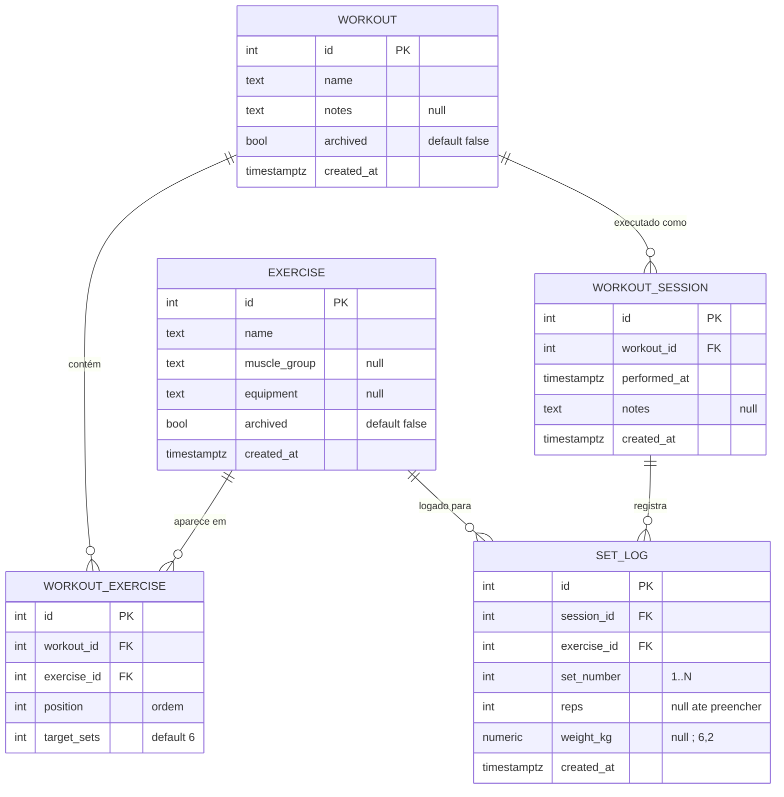

# DER — Módulo Treino

Diagrama entidade-relacionamento do módulo de treino. Detalhes de campos, regras e
a query de histórico em [`SPEC-treino.md`](./SPEC-treino.md).

## Leitura das relações

| Relação | Cardinalidade | Significado |
|---|---|---|
| WORKOUT × EXERCISE | N—N via `workout_exercise` | um treino junta vários exercícios; um exercício vive em vários treinos |
| WORKOUT → WORKOUT_SESSION | 1—N | cada vez que você faz o treino gera uma sessão (o histórico) |
| WORKOUT_SESSION → SET_LOG | 1—N | uma sessão registra várias séries |
| EXERCISE → SET_LOG | 1—N | link direto: viabiliza a comparação "última vez" por exercício |

## Chaves e integridade

- `workout_exercise`: **UNIQUE(workout_id, exercise_id)** — sem exercício duplicado no mesmo treino.
- `set_log`: **UNIQUE(session_id, exercise_id, set_number)** — uma linha por série.
- Delete: sessão → `CASCADE` nos `set_log`; exercício → `RESTRICT` (usar `archived`).
